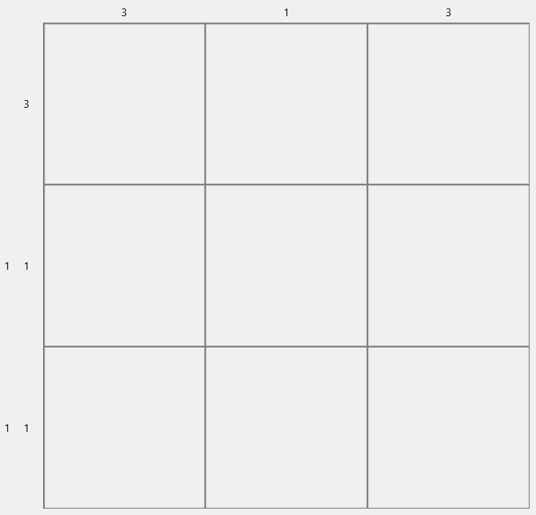

# Examples
## Creating a random puzzle and basic cell operations
The following example creates a new puzzle with a width of 5 and a height of 10.
It then fills, crosses and clears the cell located at (0, 0).
[!code-csharp]

## Using Events
The following example uses the @"NonoSharp.Nonogram.CellStateChanged"
and @"NonoSharp.Nonogram.PuzzleSolved" events to get information
about the changing puzzle state.
[!code-csharp]

## Saving/Loading solutions
The following code creates a random puzzle, saves it to disk
and then loads the [example puzzle](example_puzzle.ns).
[!code-csharp]

## Using NonogramBuilder
With @"NonoSharp.NonogramBuilder", you can create your own puzzles and convert them to a @"NonoSharp.Nonogram" instance
or save them to disk! The example below creates a 5×5 puzzle with a smiley face as solution and saves it to a file.
[!code-csharp]

## Using the built-in solver
The following example uses the built-in solver to solve the 3×3 puzzle shown below.

[!code-csharp]
